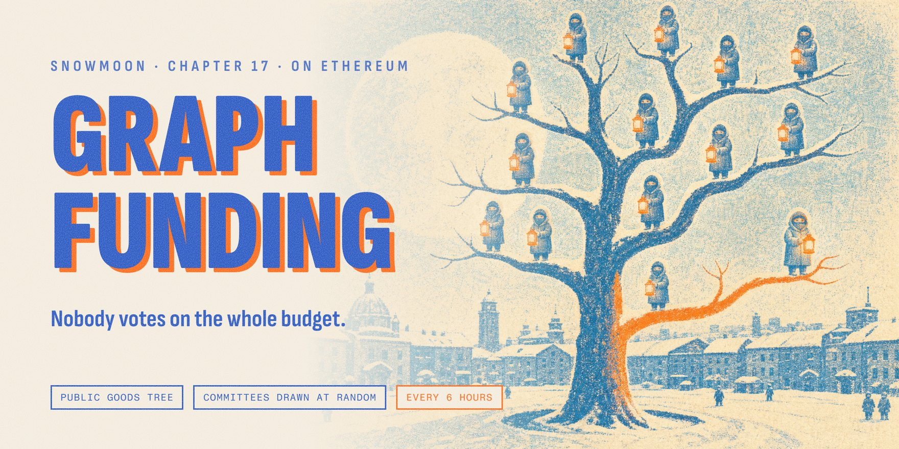
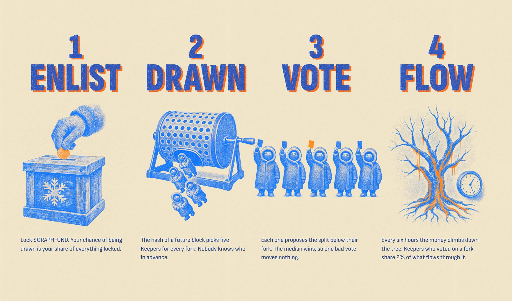
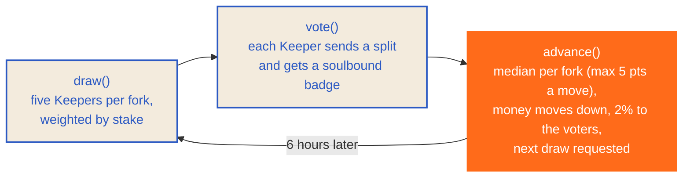
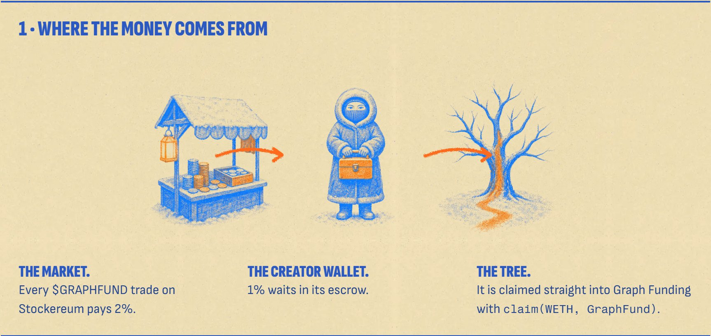
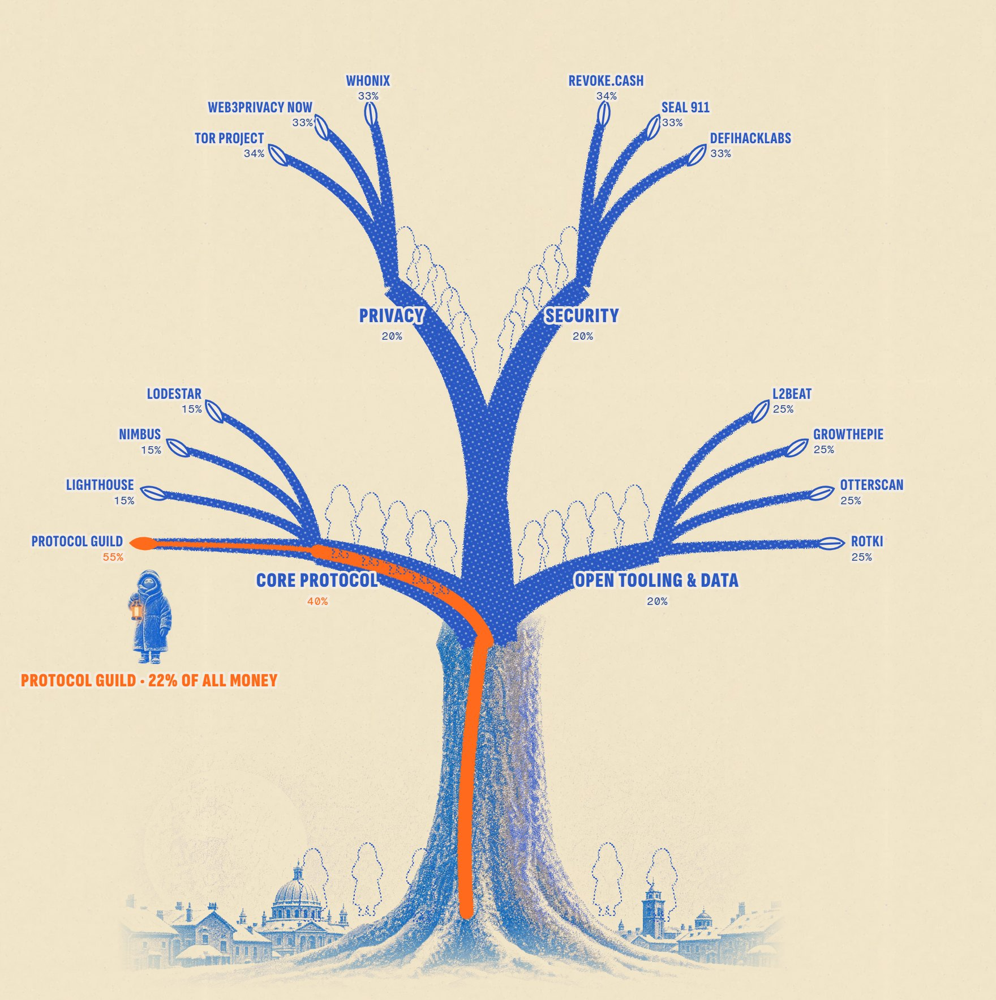

<p align="center">
  <a href="https://graphfunding.app"></a>
</p>

<p align="center">
  <a href="https://graphfunding.app"></a>
  <a href="https://x.com/GraphFunding"></a>
  
  <br />
  
  
  
  
</p>

<br />

> *"For each node on the graph, the cryptographic network randomly selects a committee, that makes the decision of
> what weights the edges right below that node get."*
> <br />**Snowmoon, [chapter 17](https://vitalik.eth.limo/snowmoon/html/chapter-17.html)**

**Graph Funding** is the public-goods funding system from *Snowmoon*, the novel by Vitalik Buterin, built for real on
Ethereum. Trading fees from the $GRAPHFUND token flow into a tree of Ethereum public goods. At every fork of the tree, a
small committee drawn at random decides how the money splits. Nobody ever votes on the whole budget.

> [!NOTE]
> **Not affiliated with Vitalik Buterin.** Lore from Snowmoon (GPL v3). Unaudited code, volatile token, no promises.

<br />

## In one minute

| 💸 Money in | 🌳 The tree | 🎲 The committees |
|:---:|:---:|:---:|
| Every $GRAPHFUND trade pays a 2% fee. Half of it is claimed straight into the contract. | Four branches, fourteen Ethereum public goods. The money climbs down from the trunk to the leaves. | At every fork, five Keepers drawn at random set the split. Every six hours the money moves. |

<br />

## How a decision is made

<p align="center"></p>

1. **Enlist.** Lock at least 100,000 $GRAPHFUND. Your chance of being drawn is your share of everything locked.
2. **Drawn.** The hash of a future block picks five Keepers for every fork. Nobody knows who in advance.
3. **Vote.** Each Keeper proposes how the money below their fork should split. The **median** wins, so one bad vote
   moves nothing, and no share moves more than **5 points per epoch**, so no single committee can hijack a fork.
   Voting mints a soulbound Keeper badge.
4. **Flow.** Every six hours the epoch closes and the money climbs down the tree. Keepers who voted on a fork share 2%
   of what flowed through it.

<details>
<summary><b>One epoch, as the contracts see it</b></summary>
<br />



`draw()` and `advance()` can be called by anyone; a small bot calls them on time. Recipients pull their money with
`payout(address)`.
</details>

<br />

## Where the money comes from

<p align="center"></p>

$GRAPHFUND trades on [Stockereum](https://stockereum.com) with a **2% fee**: 1% goes to the platform, 1% waits in the
creator wallet's escrow. The creator wallet claims it with `FeeEscrow.claim(WETH, GraphFund)`, so it goes from the
escrow **straight into this contract**. Every claim is public on Etherscan. Anyone can also send ETH to the contract.

<br />

## The graph, at genesis

<p align="center"></p>

The starting weights, before any committee has voted. From the first epoch on, the committees decide, 5 points per
epoch at most.

<table>
  <tr><th align="left">Branch</th><th align="left">Recipient</th><th align="right">Inside the branch</th><th align="right">Of every ETH¹</th></tr>
  <tr><td rowspan="4">🛠️ <b>Core protocol</b><br /><sub>40% of the tree</sub></td><td><a href="https://etherscan.io/address/0x4EA88fa76848a8BBAB72613d4171df1eBcf68399">Protocol Guild</a></td><td align="right">55%</td><td align="right"><b>22%</b></td></tr>
  <tr><td><a href="https://etherscan.io/address/0x25c4a76E7d118705e7Ea2e9b7d8C59930d8aCD3b">Lighthouse</a></td><td align="right">15%</td><td align="right"><b>6%</b></td></tr>
  <tr><td><a href="https://etherscan.io/address/0x70E47C843E0F6ab0991A3189c28F2957eb6d3842">Nimbus</a></td><td align="right">15%</td><td align="right"><b>6%</b></td></tr>
  <tr><td><a href="https://etherscan.io/address/0xb4Da52336092Db22fe8e036866d59C6488604f89">Lodestar</a></td><td align="right">15%</td><td align="right"><b>6%</b></td></tr>
  <tr><td rowspan="3">🕶️ <b>Privacy</b><br /><sub>20% of the tree</sub></td><td><a href="https://etherscan.io/address/0x532Fb5D00f40ced99B16d1E295C77Cda2Eb1BB4F">Tor Project</a></td><td align="right">34%</td><td align="right"><b>6.8%</b></td></tr>
  <tr><td><a href="https://etherscan.io/address/0xB8Fbd9A43cc0CeB3d9ddd58b752979a77e6f0c1D">Web3Privacy Now</a></td><td align="right">33%</td><td align="right"><b>6.6%</b></td></tr>
  <tr><td><a href="https://etherscan.io/address/0xf9d352E30dE38eD1173854a241074414CEa19555">Whonix</a></td><td align="right">33%</td><td align="right"><b>6.6%</b></td></tr>
  <tr><td rowspan="3">🛡️ <b>Security</b><br /><sub>20% of the tree</sub></td><td><a href="https://etherscan.io/address/0xfcBf17200C64E860F6639aa12B525015d115F863">Revoke.cash</a></td><td align="right">34%</td><td align="right"><b>6.8%</b></td></tr>
  <tr><td><a href="https://etherscan.io/address/0xba5Ed9942ea64e8D789187E0aF6a0390d78BA5ed">SEAL 911</a></td><td align="right">33%</td><td align="right"><b>6.6%</b></td></tr>
  <tr><td><a href="https://etherscan.io/address/0xD7d6215b4EF4b9B5f40baea48F41047Eb67a11D5">DeFiHackLabs</a></td><td align="right">33%</td><td align="right"><b>6.6%</b></td></tr>
  <tr><td rowspan="4">📊 <b>Open tooling &amp; data</b><br /><sub>20% of the tree</sub></td><td><a href="https://etherscan.io/address/0x41626BA92c0C2a1aD38fC83920300434082B1870">L2BEAT</a></td><td align="right">25%</td><td align="right"><b>5%</b></td></tr>
  <tr><td><a href="https://etherscan.io/address/0x9438b8B447179740cD97869997a2FCc9b4AA63a2">growthepie</a></td><td align="right">25%</td><td align="right"><b>5%</b></td></tr>
  <tr><td><a href="https://etherscan.io/address/0x35D1A101E55DA0C641e9379f2e4dfA3e2AE7F37b">Otterscan</a></td><td align="right">25%</td><td align="right"><b>5%</b></td></tr>
  <tr><td><a href="https://etherscan.io/address/0x9531C059098e3d194fF87FebB587aB07B30B1306">rotki</a></td><td align="right">25%</td><td align="right"><b>5%</b></td></tr>
</table>

<sub>¹ At genesis. Once Keepers vote, each fork they voted on keeps 2% for them. Each name links to its address on Etherscan.</sub>

> [!IMPORTANT]
> **Recipients, not partners.** None of these projects has endorsed Graph Funding. Each address was read from the
> project's own donation page and checked on-chain: see **[docs/recipients.md](docs/recipients.md)**. The tree itself
> lives in [contracts/script/genesis.json](contracts/script/genesis.json).

**New projects can join.** Anyone can propose a project under a branch with a deposit of 1,000,000 $GRAPHFUND. It
enters at 0%, gains at most 5 points per epoch, and only gets money if a committee gives it weight; the deposit comes
back the first time it does.

<br />

## Who can do what

| | Can | Cannot |
|---|---|---|
| **Keepers** | Lock $GRAPHFUND, vote on the fork they were drawn for, leave the draw and unlock | Unlock while sitting on a committee |
| **Anyone** | Call `draw()` and `advance()`, send ETH, propose a project, trigger `payout` for a recipient | Choose who gets drawn |
| **Owner** *(until renounced)* | Edit the tree and the starting weights, change parameters within fixed bounds, reject spam proposals | Touch anyone's stake, touch money owed to a project, choose who gets drawn |

The owner renounces after **28 epochs (7 days)** with committees drawn and no emergency changes.

<br />

## Contracts

| Contract | What it does |
|---|---|
| [`GraphFund`](contracts/src/GraphFund.sol) | The tree, the epochs (`draw` → `vote` → `advance`), the payouts (ETH, or WETH to contracts that refuse ETH) and the proposals |
| [`KeeperStaking`](contracts/src/KeeperStaking.sol) | Lock $GRAPHFUND (minimum 100,000) to enter the draw. Stakes can't change while a draw is pending (minutes; if nobody draws, anyone can end it with `draw()`), and stay locked while you sit on a committee. To exit: `leave()` takes you out of every future draw, then `unstake` as soon as your seat ends |
| [`KeeperBadge`](contracts/src/KeeperBadge.sol) | One soulbound token per epoch you voted in |
| $GRAPHFUND | 1,000,000,000 fixed supply, launched on Stockereum |

Addresses go here, and on the site, the moment they are deployed.

<br />

## Honest limits

- ⚖️ **Stake buys seats.** Seats are drawn in proportion to what is locked: whoever locks most of the supply wins most
  seats. The median protects a fork's split only while no one holds three of its five seats, and even a captured
  committee moves each share at most 5 points per epoch. Every seat and every vote is public.
- 🎲 **Randomness is a future blockhash.** Whoever builds that block (a role that can be bought for a single slot) can
  grind its hash and pick a committee. The 5-point cap is the answer: capturing one committee pays little, and honest
  committees undo it at the same speed. Verifiable randomness (e.g. a VRF) would close it for good.
- 🔑 **The fee claim depends on the creator wallet.** Claims into the contract are public, but someone has to make them.
- ⛽ **One transaction draws every committee.** Parameters are bounded (`committeeSize × maxNodes/2 ≤ 120`) so the worst
  case stays well under Ethereum's per-transaction gas cap.
- 🧪 **Not audited yet.** The code is open source and tested.

<br />

## Roadmap

- [x] Contracts: staking, the tree, epochs, payouts, proposals, badges
- [x] Unit and fuzz tests, plus a worst-case gas test
- [x] Site live at [graphfunding.app](https://graphfunding.app)
- [x] Mainnet-fork test against the real Stockereum (launch → trades → fees → leaves)
- [x] Deploy and genesis scripts, the keeper bot and CI
- [ ] Deploy the contracts and launch $GRAPHFUND
- [ ] First epoch, then one every six hours
- [ ] Owner renounces after 28 clean epochs

<br />

## Inside the repo

```text
contracts/src/        GraphFund, KeeperStaking, KeeperBadge
contracts/test/       unit, fuzz, worst-case gas and mainnet-fork tests
contracts/script/     Deploy, Genesis and genesis.json: the starting tree
ops/keeper/           the keeper bot: calls draw() and advance() on time
.github/workflows/    contract tests on every push + the keeper, every 15 minutes
web/                  graphfunding.app (Vite + TypeScript + viem)
brand/                the X kit, the README header and the image pipeline
docs/recipients.md    where every recipient address comes from
```

## Run it yourself

```bash
cd contracts
forge test                                                              # unit + fuzz
FOUNDRY_PROFILE=gas forge test --match-contract GraphFundFixesTest -vv  # worst-case gas, isolated
MAINNET_RPC_URL=<rpc> forge test --match-contract StockereumForkTest -vv # the real Stockereum, on a fork

cd ../web
npm install && npm run dev                                              # the site
```

### Keep the epochs moving

Nobody has to be trusted to move the money: `draw()` and `advance()` are open to anyone. This repo runs a small bot
on GitHub Actions every 15 minutes ([ops/keeper](ops/keeper/keeper.mjs)); its wallet only pays gas. Anyone can run
another one:

```bash
cd ops/keeper && npm install
RPC_URL=<rpc> GRAPHFUND_ADDRESS=<GraphFund> DRY_RUN=1 node keeper.mjs   # prints what it would do; drop DRY_RUN and
                                                                        # set KEEPER_PRIVATE_KEY to send it
```

## Images

The illustrations are risograph prints generated from the book's world; every letter on top of them is HTML with real
fonts. Snowmoon's license asks derivative works to publish their pipeline, so the prompts and curation scripts are in
[brand/pipeline](brand/pipeline).

## License

[GPL-3.0](LICENSE), like the book.

<p align="center"><br /><br /><sub>Public goods of Veridia</sub></p>
